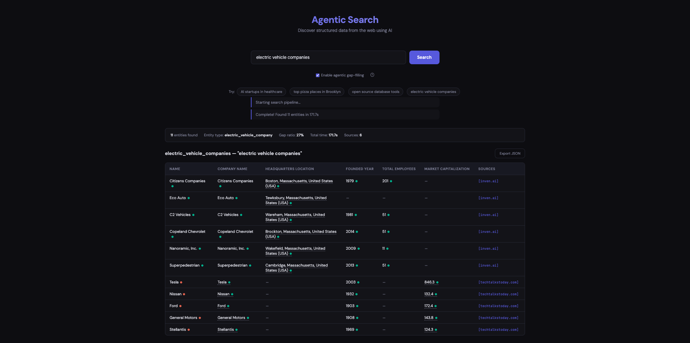

# Agentic Search

A system that takes a natural language topic query and produces a structured, source-traceable table of discovered entities — built on web search, async scraping, and local LLM extraction.




---

## What It Does

Type a query like _"open source database tools"_, _"AI startups in healthcare"_, or _"top pizza places in Brooklyn"_. The system:

1. Infers what kind of entity you're looking for and which attributes matter
2. Searches the web, scrapes the top results, and extracts structured data with an LLM
3. Deduplicates and merges findings across sources, resolving conflicts by confidence score
4. Optionally runs an agentic loop to detect gaps and fill them with follow-up searches
5. Returns an interactive table — hover any cell to see the source quote and URL that backs it up

---

## Quick Start

```bash
git clone <repo-url>
cd agentic-search
bash setup.sh
```

`setup.sh` handles everything: Python version check, Poetry installation, dependency install, `.env` creation, Ollama setup, model download, and server launch.

Then open **http://localhost:8000**.

---

## Manual Setup

If you prefer step-by-step control:

### Prerequisites

- Python 3.11+
- [Poetry](https://python-poetry.org/docs/#installation) for dependency management
- [Ollama](https://ollama.com/download) for local LLM inference

### Steps

```bash
# 1. Install dependencies
poetry install --no-root

# 2. Configure environment
cp .env.example .env
# Edit .env — add BRAVE_API_KEY if you have one (free at https://brave.com/search/api/)
# Without it, the system falls back to DuckDuckGo automatically

# 3. Start Ollama and pull the model (in a separate terminal)
ollama serve
ollama pull qwen2.5:3b   # ~1.9 GB

# 4. Run the server
poetry run python main.py
```

Open **http://localhost:8000**.

### Environment Variables

| Variable | Default | Description |
|---|---|---|
| `BRAVE_API_KEY` | `""` | Brave Search API key (optional, DDG fallback if empty) |
| `LLM_MODEL` | `qwen2.5:3b` | Ollama model to use |
| `LLM_BASE_URL` | `http://localhost:11434` | Ollama endpoint |
| `LLM_MAX_TOKENS` | `4096` | Max tokens per LLM response |
| `SEARCH_NUM_RESULTS` | `6` | Pages to fetch per query |
| `AGENT_MAX_ITERATIONS` | `2` | Max agentic gap-fill iterations |
| `AGENT_GAP_THRESHOLD` | `0.5` | Gap ratio that triggers a follow-up search |
| `RATE_LIMIT_REQUESTS` | `5` | Max requests per window per IP |
| `RATE_LIMIT_WINDOW` | `60` | Rate limit window in seconds |
| `PORT` | `8000` | Server port |

---

## API

```bash
# Health check
curl http://localhost:8000/api/health

# Run a search
curl -X POST http://localhost:8000/api/search \
  -H "Content-Type: application/json" \
  -d '{"query": "AI startups in healthcare", "enable_agent": true}'
```

### Response shape

```json
{
  "query": "AI startups in healthcare",
  "schema": { "entity_type": "company", "attributes": [...] },
  "columns": [{ "name": "name", "display_name": "Name" }, ...],
  "entities": [
    {
      "name": "Tempus AI",
      "founded_year": "2015",
      "_sources": {
        "name": { "source_quote": "Tempus AI, founded in 2015", "source_url": "...", "confidence": 0.97 }
      },
      "_source_urls": ["https://tempus.com/", "https://..."]
    }
  ],
  "entity_count": 12,
  "gap_ratio": 0.34,
  "timing": { "schema_generation": 8.2, "extraction": 64.1, "total": 87.3 }
}
```

---

## How It Works (Pipeline)

```
User Query
    │
    ▼
┌────────────────────┐
│  Schema Generation │  LLM infers entity type + attributes from query
└────────┬───────────┘
         │
         ▼
┌────────────────────┐
│    Web Search      │  Brave Search API → top N URLs (DDG fallback)
└────────┬───────────┘
         │
         ▼
┌────────────────────┐
│   Async Scraping   │  httpx fetches all pages concurrently
└────────┬───────────┘
         │
         ▼
┌────────────────────┐
│  Clean & Chunk     │  trafilatura strips boilerplate → chunked to fit LLM context
└────────┬───────────┘
         │
         ▼
┌────────────────────┐
│   LLM Extraction   │  Per-page: extract entities with value + source_quote + confidence
└────────┬───────────┘
         │
         ▼
┌────────────────────┐
│  Merge & Dedupe    │  Fuzzy name matching across pages, conflict resolution by confidence
└────────┬───────────┘
         │
         ▼
┌────────────────────┐
│   Gap Detection    │  Compute fraction of null cells
└────────┬───────────┘
         │  (if gap_ratio > threshold AND enable_agent)
         ▼
┌────────────────────┐
│   Agentic Loop     │  Generate targeted follow-up queries → re-search → merge → repeat
└────────┬───────────┘
         │
         ▼
    Structured JSON + Interactive UI
```

### Stage 1 — Dynamic Schema Generation

Rather than using a fixed schema, the LLM is asked what to extract. Given _"AI startups in healthcare"_, it decides the entity type is `company` and proposes attributes like `name`, `founded_year`, `funding_stage`, `focus_area`, `headquarters`. This means the system works for any domain without any hardcoding.

### Stage 2 — Web Search

Brave Search API is the primary provider (2,000 free queries/month, clean JSON API). DuckDuckGo is the automatic fallback — no key required. The number of results is configurable (`SEARCH_NUM_RESULTS`, default 6).

### Stage 3 — Async Scraping

All pages are fetched concurrently with `httpx` (up to `SCRAPE_MAX_CONCURRENT=8` at once). No headless browser — this keeps the stack lightweight and deployable anywhere. Pages that return 403 or timeout are silently skipped; the pipeline works on whatever it can get.

### Stage 4 — Clean & Chunk

`trafilatura` extracts the main article content from each page, stripping navigation, ads, and footers. The result is converted to plain text via `html2text`. Long pages are split into overlapping ~2048-token chunks so they fit within the LLM context window without losing cross-sentence context.

### Stage 5 — LLM Extraction

Each chunk is sent to the LLM with a structured prompt that asks for:
- The entity attribute value
- A short supporting quote from the source text
- A confidence score (0.0–1.0)

This gives every cell full provenance — not just a value, but the sentence that backs it up and where it came from. Pages are processed with controlled concurrency (semaphore of 3) to avoid saturating the local Ollama server.

### Stage 6 — Merge & Deduplication

The same entity often appears across multiple pages. `extractor/merge.py` deduplicates using fuzzy string similarity (SequenceMatcher, threshold 0.75 by default). When two records refer to the same entity, attribute values are merged by preferring higher-confidence values, and all source URLs are accumulated.

A key robustness fix: LLMs sometimes generate attribute name aliases (`company_name` instead of `name`, `found_date` instead of `founded_year`). The merger and `to_dict()` serializer both handle this with substring-matching fallback so source provenance is never lost.

### Stage 7 — Agentic Gap-Filling Loop

After the initial extraction, the system computes a **gap ratio** — the fraction of cells in the results table that are null. If this exceeds the threshold (default 50%), the agent:

1. Identifies which entities are missing which attributes
2. Asks the LLM to generate 1–3 targeted search queries (e.g., _"Rivian founded year headquarters"_)
3. Runs those queries through the full pipeline (search → scrape → extract)
4. Merges new findings into the existing table
5. Repeats, up to `AGENT_MAX_ITERATIONS` times

This is what makes the system genuinely agentic — it reasons about the quality of its own output and takes corrective action.

---

## Project Structure

```
agentic-search/
├── main.py                # FastAPI app, routes, rate limiting, static serving
├── pipeline.py            # Orchestrates the full pipeline, PipelineResult serialization
├── config.py              # All configuration via environment variables
│
├── search/
│   ├── brave.py           # Brave Search API client
│   └── fallback.py        # DuckDuckGo fallback
│
├── scraper/
│   ├── fetcher.py         # Concurrent async HTTP fetching (httpx)
│   ├── cleaner.py         # Content extraction (trafilatura + html2text)
│   └── chunker.py         # Overlapping token-aware text chunking
│
├── extractor/
│   ├── schema.py          # Dynamic schema generation via LLM
│   ├── extract.py         # Per-chunk entity extraction with provenance
│   ├── merge.py           # Cross-page fuzzy deduplication and merging
│   └── validate.py        # Gap ratio computation, gap identification, follow-up query generation
│
├── agent/
│   └── loop.py            # Agentic re-search loop (parallel follow-up queries)
│
├── llm/
│   └── client.py          # Unified LLM client (Ollama + OpenAI-compatible APIs)
│
├── frontend/
│   └── index.html         # Single-page UI with hover tooltips and source links
│
├── tests/
│   ├── test_search.py
│   ├── test_scraper.py
│   └── test_extractor.py
│
├── setup.sh               # One-shot setup and launch script
├── .env.example           # Reference for all environment variables
├── architecture.md        # Full design decision log
└── pyproject.toml         # Poetry dependency manifest
```

---

## Design Decisions

### Modular monolith over microservices
Each module (`search/`, `scraper/`, `extractor/`, `agent/`) is independently testable and has no circular dependencies. This keeps local development simple while remaining easy to split apart later. At the expected query volume, there's no operational need to scale components independently.

### Local LLM (Qwen 2.5 via Ollama) for development
Running inference locally means zero API cost during development, no rate limits, and no data leaving the machine. Ollama automatically uses Metal GPU acceleration on Apple Silicon. The `LLM_MODEL` config is a single env var — switching to a cloud provider (OpenAI, OpenRouter, DeepSeek) requires no code changes, only a `.env` update.

For the 3B model (`qwen2.5:3b`, 1.9 GB): ~10–30s per page extraction on an M-series Mac. The 7B (`qwen2.5:7b`, 4.7 GB) gives higher quality at roughly double the time.

### Dynamic schema rather than fixed columns
A static schema would only work for one category of entity. By asking the LLM to generate the schema from the query, the same codebase handles _"AI startups"_, _"pizza places"_, _"database tools"_, and anything else — each with the most relevant columns.

### Source traceability at the attribute level
Every cell value carries three pieces of metadata: the supporting quote (verbatim excerpt from the source text), the source URL, and a confidence score. The UI uses this to render hover tooltips on each cell. This makes results auditable and directly answerable: "where did this come from?"

### Fuzzy merge with confidence-based conflict resolution
When the same entity appears on five different pages with slightly different data, the merge step picks the highest-confidence value for each attribute and accumulates all source URLs. This is more principled than "last write wins" and avoids throwing away partial data from lower-quality sources.

### Agentic loop with a hard cap
Unbounded loops are a reliability risk. The agent runs at most `AGENT_MAX_ITERATIONS` times (default 2). Each iteration costs real time (another round of search + LLM calls), so the cap keeps the worst-case latency bounded while still covering the most common gaps.

### Rate limiting with a concurrency lock
Two separate protections on `POST /api/search`:
- **Sliding window per IP**: 5 requests per 60 seconds — prevents abuse
- **Global semaphore**: only 1 search runs at a time — since Ollama processes LLM calls serially, queuing concurrent searches just degrades all of them. Returning 429 immediately is better UX.

---

## Testing

```bash
poetry run python -m pytest tests/ -v
```

14 tests across search, scraper, and extractor modules.

---

## Known Limitations

| Limitation | Details |
|---|---|
| **No JS rendering** | `httpx` fetches static HTML only. React/Vue SPAs that load data client-side will return empty content. Fix: add Playwright or Jina Reader fallback. |
| **Local LLM latency** | End-to-end time is 60–200s depending on page count and model size. Cloud LLM APIs (GPT-4o, DeepSeek, Gemini Flash) would bring this under 10s. |
| **No caching** | Identical queries re-run the full pipeline every time. A Redis or SQLite cache keyed on query + schema would eliminate most repeated work. |
| **Simple deduplication** | Fuzzy string similarity catches obvious duplicates (same name, slight spelling variation) but won't catch semantic equivalence ("IBM" vs "International Business Machines"). Embedding-based matching would improve this. |
| **LLM schema consistency** | Small models sometimes generate attribute names that differ from the schema (`company_name` vs `name`). The merge and serialization layers handle this with fallback matching, but extraction quality is model-dependent. |
| **403 blocking** | High-traffic sites (Wikipedia, KBB, Edmunds) frequently return 403 to non-browser user agents. No browser emulation or residential proxy is used. |
| **List-heavy pages** | Pages listing 50+ entities (e.g., large comparison sites) often cause the LLM to truncate its JSON response mid-output. The system skips these chunks and continues with what it has. |

---

## Cost Breakdown (Local Dev)

| Component | Cost |
|---|---|
| Qwen 2.5 via Ollama | $0 |
| Brave Search (≤2,000/month) | $0 |
| Infrastructure | $0 |
| **Total** | **$0** |

---

## License

MIT
